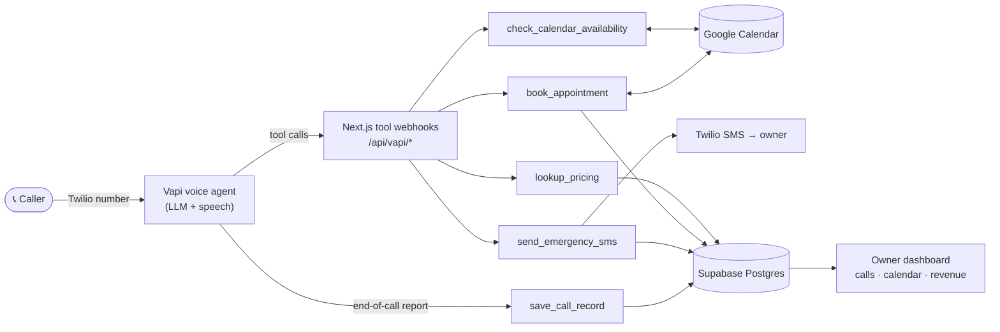

# TradeLine

**An AI phone agent for plumbers, electricians, and HVAC contractors.** TradeLine answers every inbound call, figures out what the caller needs, quotes ballpark pricing, books the job on the owner's real calendar, and texts the owner immediately when a call is an emergency. A dashboard shows every call, booking, and dollar the agent brought in.

Small trades businesses miss a large share of their calls because the owner is on a job. Every missed call is a lost customer. TradeLine is a voice agent that picks up instead, built to behave the way a good front-desk person would.

---

## How it works



During a call, the voice agent decides when to use a tool. Each tool is a typed Next.js route that runs real business logic against the contractor's data and returns a sentence the agent can say out loud.

| Tool                          | What the agent uses it for                                                                                                                                                                        |
| ----------------------------- | ------------------------------------------------------------------------------------------------------------------------------------------------------------------------------------------------- |
| `lookup_pricing`              | Matches the caller's description ("my water heater is leaking") to the contractor's price sheet and returns up to three ballpark ranges, always caveated as final only after a tech sees the job. |
| `check_calendar_availability` | Reads the owner's Google Calendar free/busy data against their business hours and offers the next open one-hour slots. Timezone-correct for the business's local time.                            |
| `book_appointment`            | Creates the booking in the database and on the owner's Google Calendar with the customer's name, phone, address, and problem summary.                                                             |
| `send_emergency_sms`          | When a caller reports something like a burst pipe, gas smell, or sparks, texts the owner a one-tap callback message and logs the emergency.                                                       |
| `save_call_record`            | Receives the end-of-call report and stores the transcript, recording, structured fields (urgency, outcome, caller info), duration, and cost.                                                      |

## Design decisions

Building an agent that talks to real customers comes down to how it behaves when things go wrong. The core choices:

- **The caller never hears an error.** Every tool has a scripted fallback. If the calendar API fails, the database is down, or the contractor record can't be found, the agent still gets a natural sentence ("I'll have the owner call you back to schedule") and the conversation keeps going.
- **No lead is ever lost.** If a booking or an emergency text fails partway through, the route still writes a best-effort record so the owner can follow up. When a text fails to send, the emergency is logged anyway and flagged loudly in the logs.
- **Tool outputs are written for the model, not for humans.** Availability results include the exact ISO timestamp next to each human-readable slot ("Tuesday, May 20 at 9:00 AM (iso: …)"), and the agent is told to pass that value back unchanged. This keeps the LLM from re-typing dates and booking the wrong time.
- **Pricing is grounded, not generated.** Prices come only from the contractor's own price sheet through token-match scoring, never from the model. When nothing matches, the agent defers to the owner instead of guessing.
- **Secure webhooks.** Tool endpoints are authenticated with a shared secret using a constant-time comparison (`crypto.timingSafeEqual`). They are excluded from session auth, while the dashboard is protected by Supabase Auth and row-level security.
- **Multi-tenant from day one.** Each contractor maps to their own Vapi assistant. Every request resolves the tenant from the assistant ID, so one deployment serves many businesses with separate pricing, hours, emergency keywords, calendars, and versioned system prompts (`prompt_versions`).
- **Clean data in, clean analytics out.** Phone numbers are normalized to E.164 at every entry point, so calls, bookings, and SMS line up on the dashboard.

## Owner dashboard

- **Overview:** today's calls, upcoming bookings, emergencies, and a revenue trend
- **Calls:** a searchable, filterable log (today, this week, emergencies, abandoned) with transcripts, recordings, urgency, and outcome, plus an editable detail drawer
- **Calendar:** agent-booked jobs with status tracking (scheduled → completed / no-show)
- **Revenue:** estimated vs. actual job value, broken down by repair type and location, to show the agent's ROI
- **Settings:** agent name and greeting, business and after-hours behavior, emergency keywords, pricing, and Google Calendar connection

## Tech stack

**Agent and voice:** Vapi (LLM orchestration, speech, tool calling), Twilio (phone numbers + SMS), ElevenLabs (voice)
**App:** Next.js 14 (App Router), React, TypeScript, Tailwind CSS, Radix UI / shadcn, Recharts
**Backend and data:** Supabase (Postgres, Auth, row-level security), Google Calendar API (OAuth2 with token refresh)
**Infra:** Vercel

## Project structure

```
src/
  app/
    api/vapi/          # Agent tool webhooks (one route per tool)
    api/google/        # Google Calendar OAuth connect + callback
    dashboard/         # Owner dashboard: overview, calls, calendar, revenue, settings
  lib/
    vapi/              # Webhook auth + tool response helpers
    google/            # Calendar free/busy + event creation with token refresh
    twilio/            # SMS
    supabase/          # Server, browser, and admin clients + generated types
    phone.ts           # E.164 normalization
db/
  migrations/          # Postgres schema + RLS policies
  seed.sql             # Demo contractor
```

## Running locally

```bash
pnpm install
cp .env.local.example .env.local   # fill in Supabase, Vapi, Twilio, Google, and OpenAI keys
# apply db/migrations/*.sql to your Supabase project, sign in once, then run db/seed.sql
pnpm dev
```

Point your Vapi assistant's tool server URLs at `https://<your-app>/api/vapi/<tool_name>` and set the same `VAPI_WEBHOOK_SECRET` in both places.

---

Built by [Arjun Chadha](https://www.linkedin.com/in/arjun-chadha-7164221b1).
